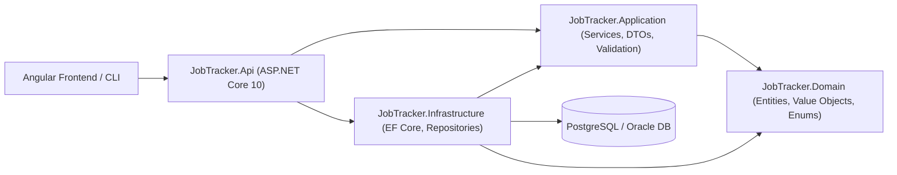
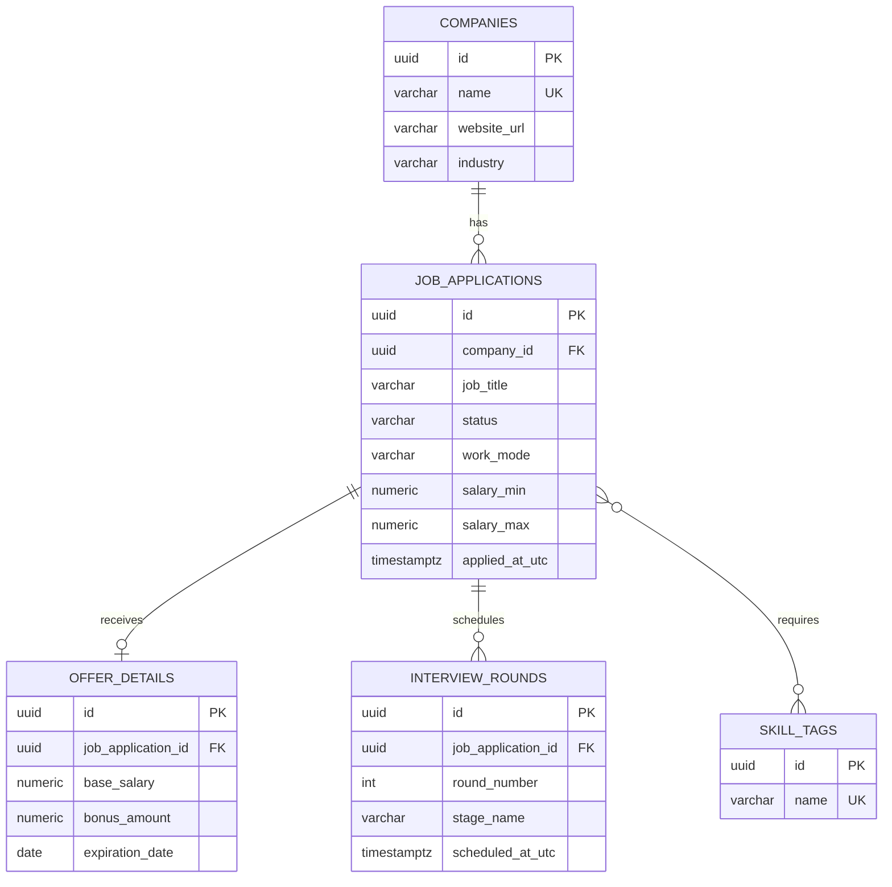

# Backend Documentation (`backend-documentation`)

## Overview
Establishes documentation architecture, Markdown standards, and Mermaid diagram templates for keeping the **Job Tracker Backend** documentation accurate, developer-friendly, and synchronized with the actual C# and database implementation.

## Activation Instructions
Activate this skill whenever you are:
- Authoring or updating `README.md`, architecture decision records (ADRs), API reference docs, database schema documentation, or `CHANGELOG.md`.
- Creating Mermaid flowcharts, sequence diagrams, or Entity-Relationship (`erDiagram`) diagrams for the backend and database.
- Documenting setup instructions, environment variables, configuration sections, CLI commands, migration procedures, or testing/coverage workflows.

## Specific Responsibilities
1. **Keep Documentation Synchronized with Implementation**: Always inspect actual `.csproj` files, `Program.cs`, controllers/endpoints, `appsettings.json`, and EF Core entities before writing documentation. Never document hypothetical endpoints or settings as if they already exist unless clearly labeled as planned architecture.
2. **Use Visual Mermaid Diagrams**: Include valid Mermaid diagrams (`flowchart`, `sequenceDiagram`, `erDiagram`) to illustrate layered architecture, request lifecycles, and relational database schemas.
3. **Provide Copy-Pasteable Runbooks**: Ensure all CLI commands (`dotnet build`, `dotnet run`, `dotnet ef`, `dotnet test`, `reportgenerator`) and environment variable tables are accurate for Windows PowerShell and cross-platform shells.

---

## Technology-Specific Implementation Guidance

### 1. Standard Backend `README.md` Structure
Every backend repository `README.md` should include:
1. **Project Overview & Key Capabilities**
2. **Technology Stack & Prerequisites** (.NET 10 SDK, PostgreSQL / Oracle, EF Core, xUnit)
3. **Architecture & Project Structure** (Mermaid diagram + directory tree)
4. **Configuration & Environment Variables** (table with variable name, config path, required/default, description)
5. **Database Setup & Migrations** (EF Core CLI commands for inspecting, scripting, and updating)
6. **Running the Application & CLI Tools** (`dotnet run`, Swagger/OpenAPI URLs)
7. **API Endpoints Summary** (HTTP method, route, auth requirement, status codes)
8. **Testing & Code Coverage** (`dotnet test`, Coverlet, ReportGenerator)
9. **Troubleshooting Guide** (common startup, database connection, and migration issues)

### 2. Architecture & Entity-Relationship Mermaid Diagrams

#### Layered Architecture Diagram (`flowchart LR`)


#### Database Entity-Relationship Diagram (`erDiagram`)


### 3. OpenAPI / XML Documentation in C# Code
Enable `<GenerateDocumentationFile>true</GenerateDocumentationFile>` (with `<NoWarn>$(NoWarn);1591</NoWarn>` where appropriate) and enrich endpoints with `[EndpointSummary]`, `[EndpointDescription]`, and `[ProducesResponseType]`:
```csharp
/// <summary>
/// Retrieves a paginated list of job applications matching the specified filter criteria.
/// </summary>
/// <param name="query">Pagination, filtering, and sorting parameters.</param>
/// <param name="ct">Cancellation token.</param>
/// <response code="200">Returns the paginated list of job applications.</response>
/// <response code="400">If pagination or filter parameters are invalid.</response>
[HttpGet]
[EndpointSummary("List job applications with pagination and filtering")]
[ProducesResponseType(typeof(PagedResponse<JobApplicationSummaryDto>), StatusCodes.Status200OK)]
[ProducesResponseType(typeof(ValidationProblemDetails), StatusCodes.Status400BadRequest)]
public async Task<ActionResult<PagedResponse<JobApplicationSummaryDto>>> GetListAsync(
    [FromQuery] JobApplicationQueryParameters query,
    CancellationToken ct)
```

See [Documentation Templates and Diagrams Reference](./references/documentation-templates-and-diagrams.md) for ready-to-use templates for Environment Variables, API Endpoint Catalogs, Troubleshooting Guides, and `CHANGELOG.md`.

---

## Common Mistakes to Avoid
1. **Documenting Real Secrets or Passwords**: Never commit real JWT signing keys, production database passwords, or API keys in `README.md` examples. Use placeholders like `<YOUR_JWT_SIGNING_KEY_MIN_32_CHARS>`.
2. **Stale Route or Port Numbers**: Always check `Properties/launchSettings.json` and controller `[Route]` attributes so documented URLs match actual runtime bindings.
3. **Invalid Mermaid Syntax**: Always quote node labels containing parentheses or special characters (e.g., `Api["JobTracker.Api (ASP.NET Core 10)"]` instead of `Api[JobTracker.Api (ASP.NET Core 10)]`).

---

## Verification Checklist
- [ ] All documented CLI commands, project paths, and launch URLs match the actual workspace structure.
- [ ] Mermaid diagrams use supported diagram types (`flowchart`, `sequenceDiagram`, `erDiagram`, `stateDiagram-v2`, `classDiagram`) and properly quote labels with special characters.
- [ ] Environment variable and configuration tables include placeholders rather than real secrets.
- [ ] Database migration, testing, and coverage instructions are complete and reproducible.

---

## Official Documentation References
- [ASP.NET Core OpenAPI Documentation](https://learn.microsoft.com/en-us/aspnet/core/fundamentals/openapi/overview)
- [C# XML Documentation Comments](https://learn.microsoft.com/en-us/dotnet/csharp/language-reference/xmldoc/)
- [Keep a Changelog Specification](https://keepachangelog.com/en/1.1.0/)
